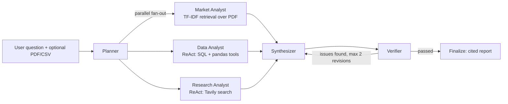

# Triangulate AI

A multi-agent market intelligence assistant. Ask a market question and three specialist agents each investigate from a different data source. A synthesizer then writes a cited report, and a verifier checks it against the evidence before it ships.

## How it works

```
Planner --> { Market Analyst, Data Analyst, Research Analyst } --> Synthesizer
                                                                       |
                                                                       v
                                                                   Verifier
                                                                   /       \
                                                       (issues found)     (passed)
                                                             |                |
                                                   back to Synthesizer       END
                                                      (max 2 retries)
```

| Agent | Data source | Method |
|---|---|---|
| Market Analyst | Uploaded PDF (internal docs) | TF-IDF retrieval |
| Data Analyst | `company_data.db` (SQLite) and an optional uploaded CSV | ReAct agent with SQL and pandas tools |
| Research Analyst | Live web | ReAct agent with Tavily search |

The pipeline is built with [LangGraph](https://github.com/langchain-ai/langgraph) and the UI with [Streamlit](https://streamlit.io). The LLM is served through [Groq](https://groq.com).

## Design write-up

### What the agent does and who it's for

Triangulate AI helps analysts and strategy teams answer a market question without manually cross-checking sources. You ask a question (optionally uploading an internal strategy PDF and a CSV). The system pulls evidence from three places (your document, internal sales data, and the live web), writes a cited strategic brief, and fact-checks that brief against the evidence before showing it.

### How it is built

- **Framework:** LangGraph (`StateGraph`) with LangChain tools, Groq-hosted Llama-3.3-70B, Pydantic for structured outputs, Streamlit for the UI.
- **Multi-agent:** an orchestrator pattern. A **Planner** decides which specialists are relevant and fans out to them in parallel; a **Synthesizer** merges their findings into a report; a **Verifier** critiques the draft.
- **Tools:** the Data Analyst is a ReAct agent with a SELECT-only, read-only SQL tool and a pandas tool for uploaded CSVs. The Research Analyst is a ReAct agent with Tavily web search.
- **RAG:** the Market Analyst chunks the uploaded PDF and retrieves the most relevant chunks with TF-IDF, then answers with chunk-level citations.
- **Memory:** a LangGraph `MemorySaver` checkpointer keeps run state per thread, and a follow-up "copilot" chat answers questions from the verified report using the recent conversation history.
- **Typed handoffs:** every agent returns a Pydantic model, so the Synthesizer and Verifier work with validated fields instead of free text.



### Key design decision and its tradeoff

**Decision:** add a Verifier that checks the draft report against the specialists' source facts and sends it back to the Synthesizer, capped at 2 revisions.

**Why:** LLM reports often sound confident while quietly adding unsupported claims or wrong numbers. Making the Verifier compare each claim with the cited evidence catches many of these before the user sees them.

**Tradeoff:** every revision costs extra LLM calls, so latency and cost go up (the app tracks per-run cost for this reason). The Verifier is itself an LLM, so it can miss a problem or flag a correct claim. The cap of 2 revisions prevents endless loops, and if issues remain after the cap, the report still ships with the remaining issues logged rather than failing the run.

Two smaller decisions: the Planner skips specialists that aren't relevant (saves cost, but a wrong routing decision means missing evidence; on failure it falls back to the Market Analyst only), and the SQL tool is SELECT-only on a read-only connection (safer, but it can't write or fix data).

### How it was tested and evaluated

Being upfront about the current state:

- **Manual end-to-end runs** on the sample sales database and sample strategy PDF, checking that routing, tool calls and citations behave as expected.
- **Automated checks inside the system:** Pydantic schemas reject malformed agent outputs (with one retry), and the Verifier acts as a runtime grounding check on every report.
- **Observability:** the UI shows the agent trace for each run and a per-run cost estimate for Groq and Tavily usage.
- **Not yet done:** there is no fixed evaluation set or automated regression suite, and no LangSmith tracing. A next step is a small set of questions with known answers to score groundedness and routing accuracy.

### Demo

No deployment yet.

## Setup

Requires Python 3.10+.

```bash
git clone https://github.com/Vedangi04/Triangulate-AI.git
cd Triangulate-AI
python -m venv venv
source venv/bin/activate
pip install -r requirements.txt
```

Create a `.env` file in the project root:

```
GROQ_API_KEY=your_groq_key
TAVILY_API_KEY=your_tavily_key
```

Optionally, recreate the sample sales database:

```bash
python setup_db.py
```

## Run

```bash
streamlit run app.py
```

## Project structure

| File | Purpose |
|---|---|
| `app.py` | Streamlit UI and live agent pipeline view |
| `market_engine.py` | LangGraph pipeline: planner, analysts, synthesizer, verifier, cost tracking |
| `tools.py` | Text chunking, TF-IDF retrieval, dataframe profiling and pandas query tools |
| `sql_tool.py` | Read-only SQL tool over `company_data.db` |
| `pdf_tool.py` | PDF reader for the `knowledge/` folder |
| `setup_db.py` | Creates `company_data.db` with mock semiconductor sales data |
| `knowledge/` | Sample internal strategy document |
